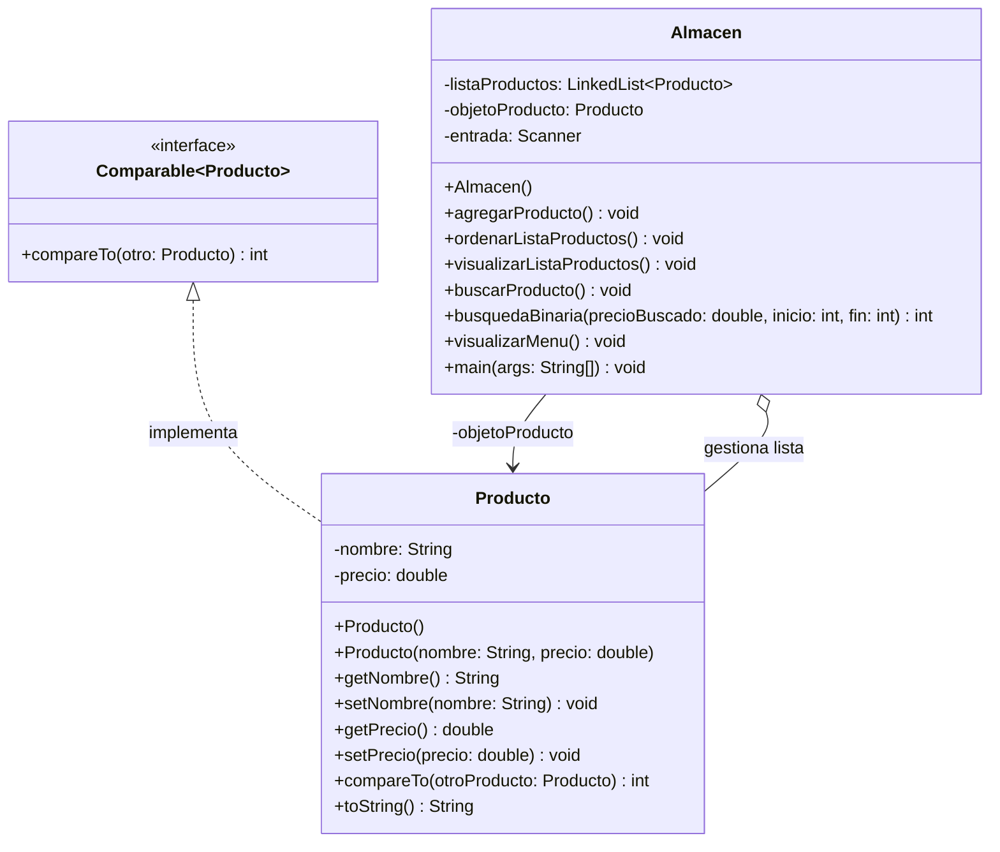

# Práctica Guiada #1: Ordenamiento y Búsqueda de Datos
**Materia:** Estructura de Datos  
**Carrera:** Ing. en Tecnologías de la Información e Innovación Digital  
**Unidad 2:** Estructuras de Datos Básicas  

---

## 📋 Descripción del Proyecto
Este proyecto implementa una solución en **Java** para la gestión de productos dentro de un almacén. Utiliza una lista enlazada (`LinkedList<Producto>`) para almacenar los elementos, aplica el ordenamiento mediante la interfaz estándar `Comparable<Producto>` (orden natural por precio) y realiza búsquedas eficientes mediante el algoritmo de **Búsqueda Binaria** implementado de forma recursiva.

---

## 📐 Diagrama de Clases UML



---

## 🚀 Compilación y Ejecución

### Requisitos
- Java JDK 8 o superior instalado.

### Pasos desde la consola / terminal:
1. Acceder al directorio `src`:
   ```bash
   cd src
   ```
2. Compilar los archivos Java:
   ```bash
   javac *.java
   ```
3. Ejecutar la aplicación:
   ```bash
   java Almacen
   ```

---

## ❓ Preguntas de la Práctica y Respuestas

### 1. ¿Cuál es la clave de ordenamiento?
> **Respuesta:** La clave de ordenamiento es el atributo numérico **`precio`** (de tipo `double`) de la clase `Producto`. El ordenamiento se realiza de forma ascendente comparando los valores de dicho atributo en el método `compareTo`.

### 2. ¿Cuál es la condición para aplicar búsqueda binaria?
> **Respuesta:** La condición fundamental e indispensable es que la colección o lista de elementos **debe estar previamente ordenada** respecto al mismo criterio/clave que se va a buscar (en este caso, ordenada por `precio`). Si la lista no está ordenada, la búsqueda binaria arrojará resultados incorrectos.

### 3. ¿Qué parte del ordenamiento modificarías para que fuera en orden alfabético?
> **Respuesta:** Se modificaría el método `compareTo(Producto otroProducto)` en la clase `Producto` (o se crearía un `Comparator` alternativo). En lugar de comparar por `this.precio`, se compararía el atributo de texto `nombre`:
> ```java
> @Override
> public int compareTo(Producto otroProducto) {
>     return this.nombre.compareToIgnoreCase(otroProducto.nombre);
> }
> ```

### 4. ¿Existe algún otro método recursivo dentro de tu programa? ¿Cuál?
> **Respuesta:** Sí. El método recursivo implementado es **`busquedaBinaria(double precioBuscado, int inicio, int fin)`** dentro de la clase `Almacen`. Este método se llama a sí mismo sucesivamente dividiendo el espacio de búsqueda en mitades (`subconjunto izquierdo` o `subconjunto derecho`) hasta encontrar el elemento o alcanzar el caso base (`inicio > fin`).
